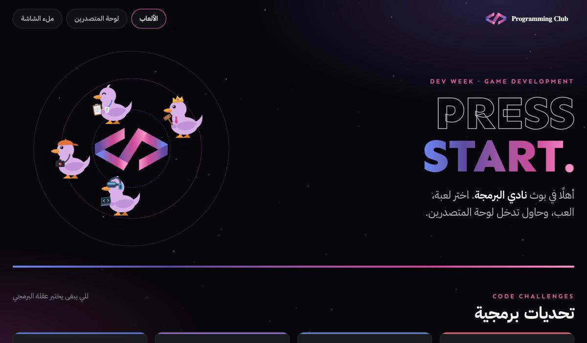
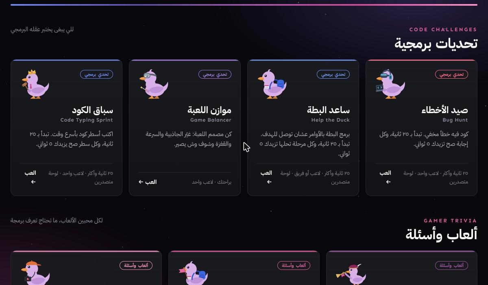
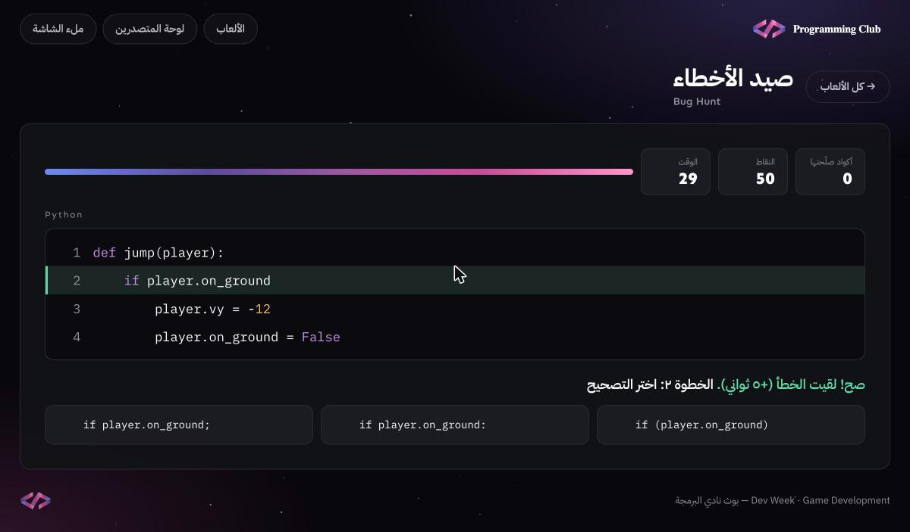
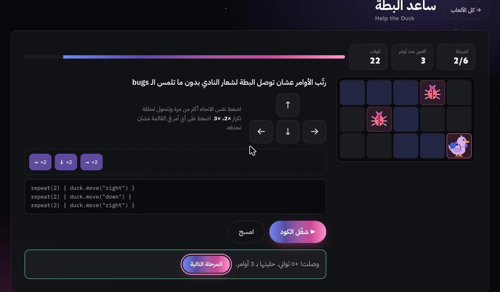
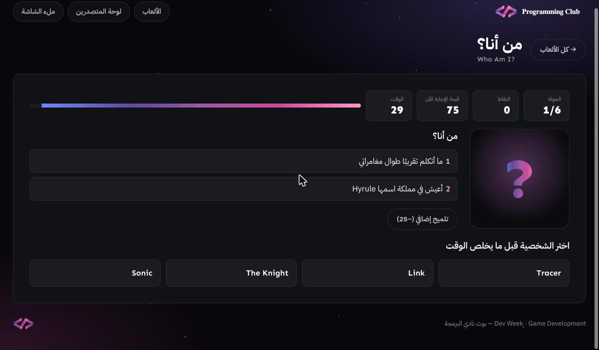

# Game Dev Arcade 🎮

**Programming Club booth games for Dev Week: Game Development**

### ▶ Play it live: **[game-dev-arcade.vercel.app](https://game-dev-arcade.vercel.app)**

An interactive arcade built for the Programming Club booth. Visitors pick a game, read a short how-to-play, and compete for a spot on the leaderboard. The whole site follows the club's visual identity: the deep-space background, the ribbon gradient and the club ducks.

## The games

### Code challenges
| Game | What it is |
|---|---|
| **Bug Hunt** (صيد الأخطاء) | Find the buggy line in a short JavaScript or Python snippet, then pick the right fix. Starts at 25 seconds, and every correct answer adds 5. |
| **Help the Duck** (ساعد البطة) | Program the club duck with direction commands and repeat loops to reach the goal without touching the bugs. 6 levels. |
| **Code Typing Sprint** (سباق الكود) | Type game-dev code lines as fast and accurately as you can. Every finished line adds 5 seconds. |
| **Game Balancer** (موازن اللعبة) | Be the game designer: tune gravity, speed and jump power while you play, and see whether the game is balanced or impossible. |

### Gamer trivia
| Game | What it is |
|---|---|
| **Who Am I?** (من أنا؟) | Guess a famous video game character from clues revealed one by one. Fewer clues means more points. |
| **Guess the Game** (خمّن اللعبة) | Name the game from an emoji puzzle before the 15-second timer runs out. |
| **Find Your Game Match** (وش نوعك كلاعب؟) | A quick 8-question quiz that reveals your player type, a character like you, and a game to play next. |

## Screenshots

| Bug Hunt | Help the Duck |
|---|---|
|  |  |

## Highlights
- Arabic-first, right-to-left interface with English game names
- Timers with time bonuses for correct answers
- Top-5 leaderboard for each game, saved on the booth device
- Works on laptops, tablets and phones

---

## Source code

The source code for this project is kept in a private repository and is not available for download.

**© 2026 RanaYaser2413481. All rights reserved.** No part of this project, including its code, design and content, may be copied, reused or redistributed without written permission. See [LICENSE](LICENSE).
